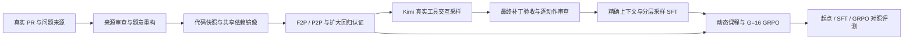

# Code Repair Agent Post-training

面向仓库级代码修复任务，基于 **Qwen3.5-9B** 和 **mini-SWE-agent**，将任务构造、教师数据采集、LoRA SFT、GRPO 与评测连接为一条可审计的后训练链路。

本仓库是代码与配置接口，不包含第三方仓库快照、隐藏测试、教师轨迹、模型权重或实验 checkpoint。实验指标与各阶段 checkpoint 的最终选择暂不填写。数据量以导入的数据清单为准，运行产生的结果保存在外部 workspace。



## 这条链路包含什么

### 真实代码修复任务构造

- 从已审查的真实 GitHub PR 和明确的 base/fix commit 构建任务；构造输入来自本地 checkout，GitHub 来源链接和审查结论单独留档。
- 接受修复前的 issue，以及与 PR 同期提交的问题描述；区分错误行为、复现条件、预期结果和具体实现方案，不机械要求 issue 早于 PR。
- 支持保留合格原描述或按需重构；没有可确认问题来源的任务进入单独的候选池，不能直接混入正式任务集。
- 分离生产补丁与测试补丁，保存轻量代码快照，复用依赖 Docker 镜像。每条轨迹启动独立容器，不为每题保存一份完整依赖环境。
- 在全新容器中验证 F2P、P2P 和扩大回归集，重复认证以检查测试稳定性；零测试、重复测试 ID、收集错误不会被当作通过。
- 按仓库隔离 train/dev/test；提供至少 10% 人工独立复核记录的冻结检查。

已有任务设计覆盖 **17 个 Python 仓库、8 类缺陷、300 题**，按仓库划分 **200/50/50**。这些是外部任务集的设计与已核实元数据，**300 题资产不随代码仓库分发**。仓库同时包含一个独立的合成任务，用于检验安装与执行流程。

### 教师数据采集与 SFT

通过可配置的 OpenAI-compatible 接口接入 Kimi，默认请求内部思考 `high`。模型名称、API 地址、token 上限及厂商参数均可替换；API 密钥仅从环境变量读取。请求 `high` 不代表已独立验证服务端实际采用的推理强度。

教师与学生使用统一的可见 `Thought + Action` 协议，环境只执行 Action 中唯一的 bash 块。轨迹保存实际发送给教师的上下文、对应学生 tokenizer 的 token ID、原始输出与执行证据。教师私有推理只作采样审计，不作为 SFT 标签或学生输入；可见 Thought 随 Action 一起训练。

质量筛选分为最终补丁验收、格式／重复／截断检测、执行证据核验，以及**具名的逐动作语义审查**。自动规则输出审查标记，不自动声称“所有验证陈述都正确”。人工复核与助手审查使用不同的 reviewer 类型。

SFT 只对输出 token 计算损失，使用语言模块 LoRA。数据准备要求教师实际输入与当前 tokenizer 精确一致，**不离线扩展教师从未看到的历史输入**。按“缺陷类型 → 完整轨迹 → 步骤样本”分层抽样，减轻长轨迹和高频动作支配训练的情况。留出集按任务划分；默认只接收整条通过验收且动作审查全部保留的轨迹。

### 细粒度奖励的 GRPO

支持从基座或兼容的 SFT LoRA 初始化；`grpo.initial_adapter` 是接口，仓库不预选实验 checkpoint。按仓库平衡、基于衰减成功率的课程策略选择训练任务，并保留随机探索。每题采样 **G=16** 条独立完整轨迹，成功后仍继续采满整组。

vLLM 批量采样与 Transformers 梯度更新使用独立进程交替占用 GPU。每组必须来自同一策略版本和 adapter 哈希。更新前用 Transformers 重算旧策略概率，检查旧／新前向在更新前是否一致；vLLM 概率与重算概率的差异只记诊断，**不使用重要性补偿，也不声称不同后端数值完全相同**。

使用经典轨迹级标准化 GRPO，同奖励组记录后从本次有效更新中排除；全批无信号不计优化步。可以保存并恢复 adapter、优化器、随机状态、课程统计和批次清单。

| 评分项 | 默认值 |
|---|---:|
| 修复通过，且无回归、修改合规 | +1 |
| 普通未修复 | 0 |
| 出现回归 | −0.25 基础分 |
| 修改违规／观测器篡改 | 最终 −1，否决成功资格 |
| 格式错误 | 每次 −0.02 |
| 保守检测到的无进展重复 | 连续第三次起，每次 −0.02 |
| 可明确归因于输出长度的未闭合 Action | 每次 −0.01，与格式扣分不重复计费 |
| 上述行为扣分合计上限 | 0.5 |
| 轨迹轮数／token 预算耗尽且无有效提交标志 | 另外 −0.25，不占行为扣分上限 |

正确补丁的成功基础分独立于终止类型；环境或 API 故障不进入失败训练样本。重复检测要求命令、文件状态、原始反馈相同，仅覆盖明确的检查／测试命令；语义改写和复杂 shell 脚本仍需要审查。

**行为事件按步骤记录，但优化器仍把整条轨迹的相对优势分配给输出 token。** 这不是动作级因果信用分配，也不保证消除 reward hacking。参见 [奖励与更新规则](docs/grpo.md)。

### 多维度评测

统一报告 pass@1、指定 k 次尝试内的成功率、回归率、格式遵循率、相邻动作重复率、终止原因及输入／输出 token 开销。pass@5 可以成功后停止该题后续尝试，节约推理开销。

SFT / GRPO 的训练内评测先评测**本次训练的起点**，后续报告与该起点比较，不把不同预算或不同任务集的结果混为一谈。Dev-50 用于诊断与选择；Test-50 保留为独立最终评测。SWE-bench Lite 提供预测文件导出接口，官方数据加载、镜像适配和官方 harness 执行仍属后续接入工作。

## 目录

```text
src/repairlab/
  tasks/         来源与任务 schema、PR 补丁拆分、认证、人工复核冻结
  agent/         mini-SWE-agent 适配、Thought/Action、上下文、Docker、pytest 证据
  teacher/       Kimi API、采集、自动分诊、逐动作审查接口
  sft/           精确上下文数据准备、分层采样、训练流程
  grpo/          奖励、动态课程、同组采样、训练流程
  backends/      Transformers/Unsloth 更新、vLLM 服务与进程切换
  evaluation/    pass@k、诊断指标、起点比较、SWE-bench 预测导出
configs/         可复制的参数模板，不包含密钥或本机路径
examples/        任务构造输入示例
requirements/    训练与推理分环境的版本参考
docker/         共享依赖镜像模板
tests/          协议、数据、奖励、采样与评测检查
docs/           安装、数据契约、运行方法与边界
```

## 快速开始：无需模型或教师 API

要求 Python 3.11、Git 和具有 Docker 访问权限的 Linux 环境。

```bash
python3.11 -m venv .venv
source .venv/bin/activate
pip install -e '.[test]'
repairlab --help
repairlab doctor
pytest -q

docker build -f docker/Dockerfile.tasks -t repairlab/tasks:py311 .
repairlab smoke --output /tmp/repairlab-smoke --image repairlab/tasks:py311
```

Smoke 测试创建一个合成代码缺陷，完成补丁拆分、F2P/P2P 与回归认证、真实 mini-SWE-agent + Docker 交互、最终隐藏测试验收和动作审查包生成。模型回复采用明确标记的脚本 fixture，**不调用教师、不占用 GPU，也不代表模型能力评测**。重复运行时使用新的空输出目录。

## 使用自己的数据和模型

先按 [安装说明](docs/setup.md) 建立训练与 vLLM 两个环境。两个环境都安装本仓库，避免 vLLM 与训练后端的 Torch 依赖互相覆盖。

```bash
cp configs/pipeline.example.json configs/pipeline.local.json
export REPAIRLAB_MODEL=/absolute/path/to/Qwen3.5-9B
export REPAIRLAB_VLLM_PYTHON=/absolute/path/to/vllm-env/bin/python
```

编辑配置中的 workspace、模型 revision、依赖镜像和训练参数。所有阶段共用同一份配置；相对 workspace 路径相对于配置文件目录解析。更改已启动运行的配置应创建新的 run 名称。

```bash
# 1. 来源人工／助手审查后，将 task-spec 中 status 改为 approved 并补齐证据。
repairlab --config configs/pipeline.local.json tasks build --spec /path/to/reviewed-task-spec.json
repairlab --config configs/pipeline.local.json tasks certify
repairlab --config configs/pipeline.local.json tasks inspect
# 人工独立复核记录齐备时执行：
repairlab --config configs/pipeline.local.json tasks freeze --human-reviews /path/to/human-reviews.json

# 2. 开启 teacher.enabled，配置实际 Kimi model ID 与 API 地址。
export TEACHER_BASE_URL=https://your-provider.example/v1
export TEACHER_MODEL=your-kimi-model-id
read -rsp 'Teacher API key: ' TEACHER_API_KEY; export TEACHER_API_KEY; echo
repairlab --config configs/pipeline.local.json teacher collect --run teacher-v1
repairlab --config configs/pipeline.local.json teacher audit --trajectories workspace/runs/teacher-v1

# 3. 对 action-review.jsonl 每一行填写具名审查结果，之后准备训练集。
repairlab --config configs/pipeline.local.json sft prepare --reviews workspace/runs/teacher-v1/action-review.jsonl
repairlab --config configs/pipeline.local.json sft train --run sft-v1

# 4. 根据自己的实验选择 grpo.initial_adapter（或 null 表示基座），再启动新 run。
repairlab --config configs/pipeline.local.json grpo --run grpo-v1
```

输入字段与审查记录见 [数据契约](docs/data-contracts.md)。完整命令、评测与恢复规则见 [运行手册](docs/running.md)。API 采集默认关闭；示例不含任何已授权账单或密钥信息。运行配置不会自动读取 `.env`。

## 默认资源与参数

- Qwen3.5-9B，BF16，LoRA `r=16, alpha=32`，仅语言模块；不默认量化。
- 输入 7,168、输出 1,024、工具反馈 1,536 token；每条轨迹最多 40 轮、累计输出 16,384 token。
- 训练 SFT 学习率 `1e-5`；GRPO 学习率 `1e-6`、warmup 5 步、clip 0.2、无 KL 项。
- GRPO 每次选择 2 道题，每题 G=16，4 条并发；动态排除同奖励组，按实际优化更新计数。
- GRPO 训练采样 `temperature=1, top_p=1`；评测 `temperature=0.7, top_p=0.9`。
- 面向单卡约 32 GiB 的采样／训练交替部署；具体显存与速度依赖驱动、软件版本、轨迹长度和并发，部署后需要容量检查。

这些是起始配置，不是实验结论。本代码整理版本的验证范围、与本机实验的区别见 [实现状态](docs/implementation-status.md)。

打包验收记录见 [validation](docs/validation.md)。
